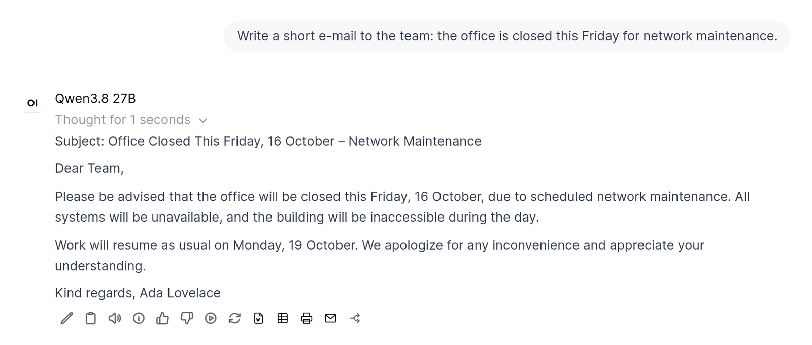

# Company Context

An Open WebUI **filter** that adds a short system note to every request, the same for every model and
assistant, including newly created ones. Example with `company_name = Example Ltd` and an English
user interface:

```text
[Company context]
You are the internal AI assistant of Example Ltd.
Always answer in English unless the user writes in another language or explicitly asks for a different one.
Address the user formally. Texts you write for them (e-mails, letters) should also use a formal tone unless they ask otherwise.
Today is Monday, 12 October 2026 (calendar week 42).
The user's name is Ada Lovelace.
```

With a company profile and a section for the user's group (see [below](#company-profile-and-groups)),
those come before the date:

```text
[Company context]
You are the internal AI assistant of Example Ltd.
Always answer in English unless …
Address the user formally. …

Company information:
Sites: Leeds (head office), York. IT help desk: extension 400.

Information for Sales:
Price lists: P:/Sales/Prices. Discounts above 10 % need the head of sales.

The user belongs to: Sales.

Use this information where it fits the question. Do not make up company details that are neither given here nor in the sources of this chat (people, phone numbers, prices, deadlines, rules); say that you do not know them instead.

Today is Monday, 12 October 2026 (calendar week 42).
The user's name is Ada Lovelace.
```

With a German user interface (or `language = de`) the note is written in German, with German dates
(`Heute ist Montag, 12. Oktober 2026 (Kalenderwoche 42).`) and *Sie*/*du* as the form of address.
The calendar week (ISO 8601) is included because models often get weekdays and weeks wrong.

- If the request already has a system message, the note is put in front of it and the existing
  prompt is kept. Otherwise a new system message is added. That system message holds the system
  prompt of the chat (chat controls), of the user's settings or of a folder. The model's own system
  prompt (**Workspace → Models**) is added by Open WebUI only after the filter, in front of the note,
  so the model receives `{model prompt}`, then the note, then the chat's system prompt.
- The date is today's date in the user's time zone: the `timezone` valve if it is set, otherwise
  the time zone of the user's browser, otherwise the server's.
- The note starts with a marker line, so it is never added twice to the same request.
- The note contains the date but not the time. It opens the prompt, so it has to stay the same all
  day: then the model server (llama-server, vLLM, Ollama) can reuse its prompt cache instead of
  processing the whole chat again on every turn.
- The parts that are the same for everybody come first, then the texts of the user's groups, then
  the date and the user's name. So the model server can also share the cached start of the prompt
  between users (vLLM's prefix caching, for example), and between the members of a group.



## Company profile and groups

`company_profile` is for facts that many questions need and that are short: sites, departments,
products, internal abbreviations, who to ask for what. Every request carries the note, so keep it to
about 2000 tokens (~8000 characters); above that the plugin writes a warning to the log. Longer texts
such as handbooks and policies belong in a knowledge base that the model searches when it needs them.
The note tells the model not to make up company details that are not given, which models otherwise
tend to do once they know a few facts about the company.

`group_profiles` holds texts for single user groups (**Admin Panel → Users → Groups**), for example
departments. Each group gets a section headed `## <group name>`; `###` and smaller headings are part of
the section's text:

```markdown
## Sales
Price lists: P:/Sales/Prices. Discounts above 10 % need the head of sales.
## HR
Holiday requests go through the HR portal; questions to hr@example.com.
## Warehouse
```

- A user gets the sections of the groups they belong to, in the order of the sections. In Open WebUI
  0.12 a member of a subgroup also gets the section of its parent group.
- Group names are compared without regard to case and extra spaces.
- A heading without text only tells the model that the user belongs to the group (with
  `include_group_names` on), which already helps it to fit its answers to the department.
- Section names that match no group (a typo, a renamed or deleted group) are written to the log. The
  plugin compares them with the groups when the valve changes and then every 10 minutes.
- Text before the first heading belongs to no group and is left out, with a warning in the log.
- Groups are the same ones that decide who may use which model or knowledge base. The note is no
  access control of its own: anything in a section reaches every member of that group.

## Install

File: [`company_context.py`](company_context.py). Install it under **Admin Panel → Functions** and
enable it globally, see [Installation](../README.md#installation). Set `company_name` in its valves,
and `timezone` if all users should get the date of one time zone.

## Valves

| Valve | Default | Description |
|---|---|---|
| `priority` | `0` | Filter order (lower runs first) |
| `language` | `auto` | Language of the note and date format: `auto` (the user's interface language, English if there is no translation), `en` or `de` |
| `company_name` | _(empty)_ | Your company name. Empty leaves out the company line |
| `response_language` | _(empty)_ | Language the assistant should answer in, written in the note's language (e.g. `English`, `Deutsch`, `French`). Empty means the note's language |
| `form_of_address` | `formal` | `formal` or `informal` (German: *Sie* / *du*), also for texts written for the user |
| `timezone` | _(empty)_ | IANA time zone that determines today's date, e.g. `Europe/Berlin`. Empty means the user's browser time zone, or the server's if the browser sends none (API requests). An unknown name counts as empty |
| `include_user_name` | `true` | Tell the model the user's display name, e.g. for e-mail signatures |
| `extra_rules` | _(empty)_ | Additional house rules for the note |
| `company_profile` | _(empty)_ | Short facts about the company for every user, see [above](#company-profile-and-groups) |
| `group_profiles` | _(empty)_ | Texts for single user groups, one `## <group name>` section each |
| `include_group_names` | `true` | Tell the model which of the groups in `group_profiles` the user belongs to |

## Security & privacy

No network access, nothing is stored. Only the system message is changed and user messages are left
untouched. With `group_profiles` set, the plugin reads the user's groups and the names of all groups
from Open WebUI's database. With `include_user_name` on, the user's display name from Open WebUI is sent to the model
(line breaks removed, at most 100 characters).
