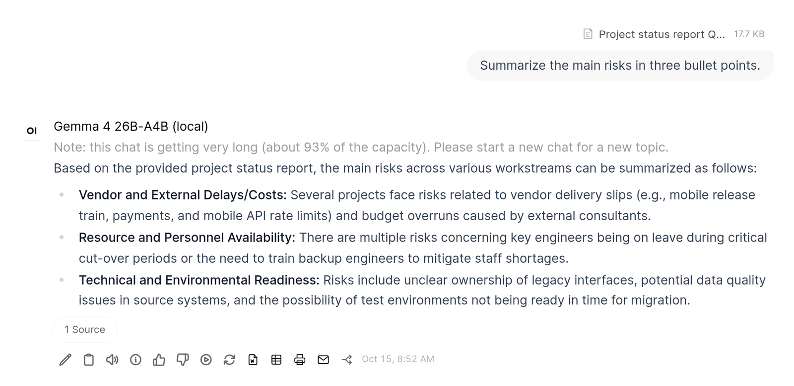
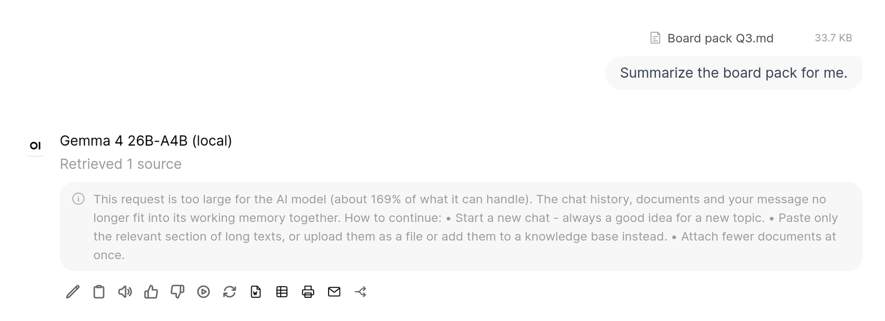

# Context Guard

An Open WebUI **filter** that estimates the prompt size right before each request is sent to the model
and warns or stops before the context window overflows.

- Runs on the `request` hook (new in Open WebUI 0.11). It runs **after** document excerpts
  (RAG/files) have been injected and again after every tool-call round, so everything the model
  will see is counted.
- Once the prompt uses `warn_percent` of the usable context, a status line appears above the
  answer. The usable context is the context size minus `answer_reserve_tokens`.
- If the prompt would not fit, the request is stopped with a friendly explanation and next steps:
  start a new chat, paste less text, attach fewer documents.

Why this helps: **llama-server** and **vLLM** reject oversized requests with a technical HTTP 400
error ("exceeds the available context size"). **Ollama** silently cuts off the oldest part of the
prompt, so the model quietly forgets earlier messages or documents.

The token count is an **estimate** (characters ÷ `chars_per_token`, plus a flat amount per image
and the JSON size of tool definitions and tool calls), not a real tokenizer. Lower
`chars_per_token` to be more cautious.

## Install

File: [`context_guard.py`](context_guard.py). Install it under **Admin Panel → Functions** and
enable it globally or per model, see [Installation](../README.md#installation). Set
`context_tokens` to the context size of your model.

## Valves

| Valve | Default | Description |
|---|---|---|
| `priority` | `100` | Filter order (lower runs first). Keep it high so content added by other filters is counted |
| `language` | `en` | Language of the warning and error messages (`en` or `de`) |
| `context_tokens` | `32768` | Context size of your model: llama-server `--ctx-size`, vLLM `--max-model-len`, Ollama `num_ctx` |
| `model_context_tokens` | _(empty)_ | Optional per-model sizes as `model_id=tokens` pairs, e.g. `qwen3-32b=40960, llama3.1:8b=8192`. Other models use `context_tokens` |
| `answer_reserve_tokens` | `6000` | Tokens kept free for the answer, including reasoning |
| `chars_per_token` | `3.5` | Characters per token for the estimate (English about 4, German about 3.5 to 4.3) |
| `tokens_per_image` | `300` | Estimated tokens per attached image |
| `warn_percent` | `75` | Show the hint from this share of the usable context (percent) |

If `answer_reserve_tokens` is not smaller than the context size, the check is skipped and a
warning is logged, so a misconfiguration never blocks every chat.

## With Context Compaction

Open WebUI's built-in [Context Compaction](https://docs.openwebui.com/troubleshooting/context-window/)
(off by default) summarizes older messages once a chat passes a token threshold. It works together
with the guard:

- Compaction runs before the filters, so the guard checks the shortened history including the
  summary.
- As long as compaction will summarize the chat before the limit, the hint to start a new chat is
  not shown. It still appears if the prompt stays above the compaction threshold, for example
  because of large documents.
- The guard stays the safety net. Compaction skips a turn when no earlier message can be cut off,
  and the summary request contains the whole chat, so after a large paste it can overflow itself.
  The guard then stops the request with its message.
- Long tool-call loops: Open WebUI 0.12.0 also compacts between the rounds, before the guard checks
  each round. In 0.11.4 only the guard covers a loop that keeps growing.
- If the compaction threshold is not below the usable context, compaction never runs before the
  guard stops a chat. The default of 80000 tokens is above most local context sizes. The guard logs
  a warning once in that case.

Set `CONTEXT_COMPACTION_TOKEN_THRESHOLD`, or a model's `compact_token_threshold`, to about **half
the context size**, e.g. `16000` for a 32k model. Compaction is only checked at the start of a turn,
and the summary request is about as large as the whole chat, so a threshold close to the limit
leaves too little room.

In Open WebUI 0.11.4 and 0.12.0, running `/compact` right after the guard stopped a request does
not help: Open WebUI stores the summary on the empty error message and skips that message when it
builds the next request. That is why the stop message suggests a new chat, not `/compact`.

## Security & privacy

Read-only: the request is never modified. No network access, nothing is stored, and no message
content is logged. Open WebUI's Context Compaction settings are only read.
