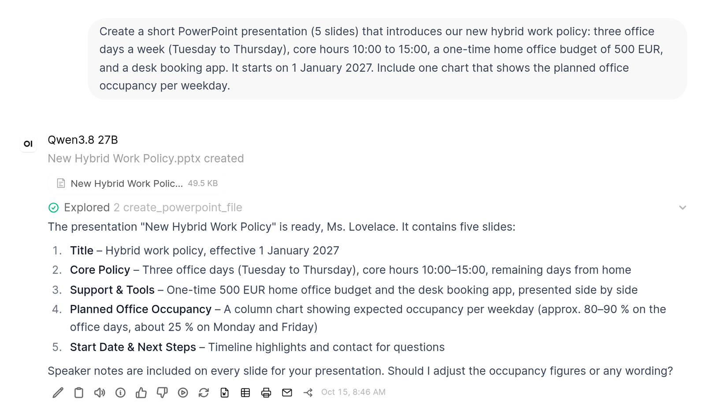
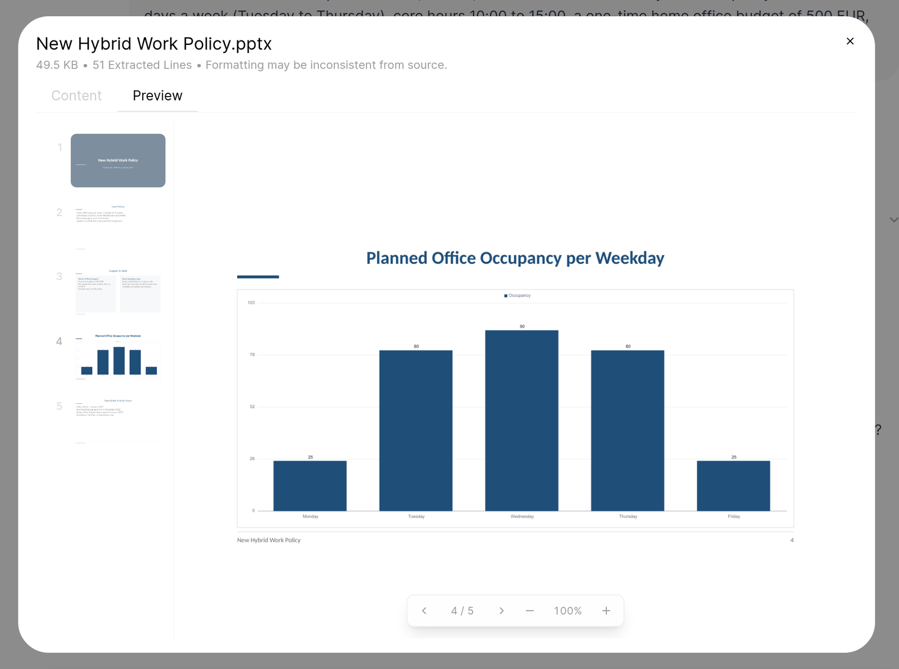
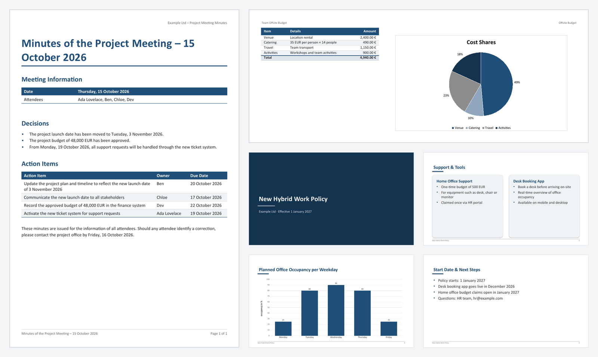

# Office Documents

An Open WebUI **tool** that lets the model create Office files itself: "Write the minutes as a Word file", "Make
me a budget in Excel", "Turn this into a presentation". The model does not write any code. It fills in
a fixed JSON schema, the tool checks it and builds the file. The finished file is attached to the
answer, where the user can preview and download it.

| Tool function | What the model can use |
|---|---|
| `create_word_file` | Title and subtitle (or none, e.g. for a letter), table of contents (at the top or where the model places it), headings (3 levels), paragraphs, bullet and numbered lists (2 levels, numbering restarts for each list), tables with a coloured header row that repeats on every page, column widths fitted to the content and numbers aligned right, quotes, page breaks, text in the page header, "Page X of Y" footer, landscape pages |
| `create_excel_file` | Several sheets with typed columns (`text`, `number`, `integer`, `currency`, `percent`, `date`, `time`), formulas per column, a total row (`sum`, `average`, `min`, `max`, `count`) and up to four native Excel charts per sheet (column, bar, line, pie, optionally with the unit at the value axis). Header row coloured and frozen, with an auto filter and fitted column widths; printed on one page width |
| `create_powerpoint_file` | 16:9 slides with the layouts `title`, `section`, `bullets`, `two_columns`, `table` and `chart` (native PowerPoint charts: column, bar, line, pie, optionally with the unit at the value axis), plus speaker notes |

Inline `**bold**`, `*italic*` and `[links](https://…)` work in all text fields of Word and PowerPoint;
in Excel cells the markers are removed: a cell that is one link becomes a clickable link, other links keep
their address in brackets (`Wiki (https://…)`). Windows paths keep their backslashes (`\\fs01\Vertrieb\_Archiv`,
`C:\Daten\*.xlsx`); a path with every backslash doubled (`\\\\fs01\\Vertrieb`) is read as escaped Markdown. File
names come from the title, e.g. `Budget 2026.xlsx`.







## Setup

File: [`office_documents.py`](office_documents.py).

1. Install it under **Workspace → Tools** (not under Functions), see [Installation](../README.md#installation).
2. Enable it for a model: **Workspace → Models → (model) → Edit**, tick **Office Documents** under
   *Tools*. Users can also switch it on per chat in the **Integrations** menu of the chat input.
3. In the same model settings, set **Advanced Params → Function Calling** to **Native**. The tool
   needs a model and server with tool calling (llama-server with `--jinja`, vLLM with
   `--enable-auto-tool-choice` and the model's `--tool-call-parser`).
4. Set **max_tokens** there as well (e.g. `8192`), so a model that gets stuck in a loop while
   writing the arguments stops after a while.

## What the model sends

A short example for a slide deck (the model sees the full schema with descriptions):

```json
{
  "title": "Quarterly report Q3",
  "slides": [
    {"layout": "title", "title": "Quarterly report Q3", "subtitle": "Sales"},
    {"layout": "bullets", "title": "Results", "bullets": ["Revenue **+12 %**", "- mostly online"], "notes": "…"},
    {"layout": "chart", "title": "Revenue", "chart": {"type": "column", "categories": ["Q1", "Q2", "Q3"],
      "series": [{"name": "2026", "values": [11, 13, 14]}]}}
  ]
}
```

- **Excel values:** numbers as JSON numbers, percentages as `12.5` for 12.5 %, dates as `YYYY-MM-DD`,
  times as `hh:mm`. Text such as `1.234,56 €`, `$1,200.00`, `CHF 1’234.50` or `7,5 %` is converted too. A
  separator followed by exactly three digits is read as thousands (`1.500`), except after a leading zero
  (`0,125`) and for the decimal mark of the `language` valve when it appears only once (`de`: `1,799` is
  1.799; `en`: `1.500` is 1.5). Values of the same column that show their decimal mark (`2.350,50`, `980,00`,
  `1,234,567`) decide it for the whole column, also against the `language` valve, so `1.500 €` next to
  `2.350,50 €` is 1500 in English too; a column with both marks next to a value they decide (`1.500`) is sent
  back. Columns sent without a type whose values are all numbers become number columns, so sums and charts
  work; values with leading zeros (postal codes, article numbers) stay text. Columns without a type whose
  values are all dates (`2026-11-02`, `02.11.2026`) or times (`08:00`) become date or time columns.
  `true` and `false` are Excel's TRUE and FALSE (WAHR and FALSCH in German Excel), in Word and slide tables
  Yes and No (Ja and Nein with `language = de`).
- **Years and numbers** are shown without thousands separators (`2024`, not `2.024`): whole numbers in a column
  without a total whose header says so (`Jahr`, `Year`, `Nr.`, `Pos.`, `Kundennr.`, `Rechnungsnummer`,
  `Order no.`, `ID`, `PLZ`, `ZIP code` …).
- **Currencies:** a `currency` column is shown in the currency of the `currency` valve, unless its values
  name another one (`$1,200.00` gives a dollar column, also for the formula columns computed from it).
  Values with different currencies in one column are sent back.
- **Dates and times:** `22.10.26` is read as 22 October 2026; `05/11/2026` (5 November or 11 May?), a date
  without a day (`2026-11`), a day that does not exist (`31.11.2026`) and numbers in a date column are sent
  back instead of being kept as text. A value with a time (`2026-10-22 14:30`) shows the time too; ISO
  timestamps (`2026-10-23T08:30:00Z`, `…+02:00`, `… 08:30:15.250`) keep the time as written, without the time
  zone (Excel has none). Dates before 1 March 1900 are written as text (`18.01.1871`): Excel shows no earlier
  dates, and up to that day Excel and LibreOffice count one day apart. A `time`
  cell holds the fraction of a day, as in Excel: `=C{row}-B{row}` in a `time` column shows 8:30 (total row
  and formula columns as `[h]:mm`, so sums above 24 hours stay right), while hours as a number need a
  `number` column with `=(C{row}-B{row})*24`. The two slips with this (times subtracted in a number column,
  which shows 0.35 for 8:30, and `*24` in a time column, which shows 204:00) are sent back.
- **Percent cells hold the fraction**, as in Excel: `12.5` is stored as 0.125 and shown as 12.5 %, so a
  formula uses the cell as it is (`=B{row}*(1-C{row})` for a discount in C). The tool sends back three
  slips that models make with this (35 of 660 Excel calls in the v0.1 runs of
  [office-bench-de](https://github.com/tovren/office-bench-de)): fractions sent into a percent
  column (`0.05` for 5 %, which would show as 0.05 %; a value below 1 % can be sent as `"0.5 %"`), a
  percent cell divided by 100 in a formula, and `*100` in the formula of a percent column (25 % would
  show as 2500 %). A percent cell divided again in another way (`D{row}%`, `(D{row})/100`, `D{row}*0.01`) is
  sent back too.
- **Excel formulas** belong to a column and are filled into every data row, e.g. `=B{row}*C{row}`
  (`{row}` is the current row). A formula written for the first data row (`=B2*C2`, `=B2/SUM(B2:B4)`) gets
  `{row}` automatically; a range over several rows (`SUM(B2:B9)`, `SUM($B$2:B9)`, also the start of
  `B2:B{row}`) is the same range in every row and is written as one (`$B$2:$B$9`), and a whole column (`B:B`, `'Data'!$A:$A`) becomes
  the data rows of that sheet, without the header and the total row; in a total written into a cell below
  the data (`=SUM(B:B)` in `B4`) it ends in the row above (`$B$2:$B$3`). Cells without `{row}` in one other row
  (`=B3*C3`, `=B1*C1`, `=B{row}*C2`) are sent back: either the rows were counted wrong (row 1 is the header)
  or a fixed cell is meant, which is written `$C$2`. `{row-1}` is not possible; a running balance goes into
  the cells. Allowed are cell references of the same workbook, numbers, quoted text, operators and these
  functions: `SUM`, `AVERAGE`, `MIN`, `MAX`, `MEDIAN`, `COUNT`, `COUNTA`, `COUNTIF`, `COUNTIFS`, `SUMIF`,
  `SUMIFS`, `AVERAGEIF`, `AVERAGEIFS`, `IF`, `IFERROR`, `AND`, `OR`, `NOT`, `ROUND`, `ROUNDUP`, `ROUNDDOWN`,
  `ABS`, `PRODUCT`, `SUMPRODUCT`, `POWER`, `SQRT`, `MOD`, `INT`, `VLOOKUP`, `INDEX`, `MATCH`, `DATE`, `TODAY`, `YEAR`,
  `MONTH`, `DAY`, `EDATE`, `EOMONTH`, `NETWORKDAYS`, `WEEKDAY`, `TIME`, `HOUR`, `MINUTE`, `LEFT`, `RIGHT`,
  `LEN`, `CONCATENATE`, `ISBLANK`, `ISNUMBER`, `ISTEXT`, and the newer `XLOOKUP`, `IFS`, `MAXIFS`, `MINIFS`,
  `CONCAT`, `TEXTJOIN` (written with Excel's `_xlfn.` prefix; they need Excel 2019 or later, `XLOOKUP` Excel
  2021 or Microsoft 365, and show `#NAME?` in older versions). German names (`SUMME`, `WENN`, `SVERWEIS`,
  `NETTOARBEITSTAGE` …), `;` as separator, decimal commas (`=RUNDEN(B{row}*0,19;2)`) and German quotes
  (`„ja“`) are translated. Formulas Excel cannot read are sent back with the place: an operator without a
  value (`=B2*`, `=B2*/2`, `==B2`), a missing argument, or a wrong number of arguments (`=ROUND(B2)`,
  `=SUM()`; the message shows how the function is written). Functions models often try get an alternative
  (`TIMEVALUE`: a `time` column). `SUMPRODUCT` takes cells and ranges of the same size
  (`=SUMPRODUCT($B$2:$B$9;$C$2:$C$9)`); conditions or products inside it (`(A2:A9="x")*C2:C9`) are sent back
  with `SUMIFS` as the way to sum with a condition. The total row's `count` counts all
  filled cells (`COUNTA`). Formulas may also be written into single cells, e.g. a balance row `=B2-B3`,
  `=C2-C3` … when the months are columns; they are checked against the same whitelist, and one that is not
  allowed is sent back (only one with a function such as `HYPERLINK` stays text, see Security). In columns
  the model marks as `text`, a formula that gives text (`=IF(F11>0;"Nachzahlung";"Guthaben")`, a label of
  another sheet) is a formula too; values that do not look like one (`=1+1`, `= Summe`, `=> siehe unten`)
  stay text. A `'` before the `=` writes the rest as text, as in Excel (`'=SUMME(B2:B9)`).
- **Sum rows below the items** (net, VAT, gross, subtotals per cost centre) are rows with their own
  formulas. A formula sent in a row of a formula column replaces the column formula in that row
  (`=SUM(F2:F6)` below `=D{row}*E{row}`), and the column formulas that have nothing to compute in such a row
  are left out instead of showing 0. The column formula written out for each row (`=B2*C2`, `=B3*C3` …) is
  not a sum row: the column formula applies. Charts and the auto filter end above the sum rows at the end of
  the table. Sent back: a formula that uses its own cell (`=SUM(F2:F7)` in F7), a subtotal (`SUM`, `SUMIF`) in a
  column with `total`, which would be counted twice (a discount row such as `=-ROUND(SUM(F2:F6)*0.05,2)` is
  meant to be in the total), and a formula that uses a cell of its own sheet that can only be meant by a
  wrong row count: outside the table, in an empty row, or a formula column's cell with nothing to compute.
  The message lists the rows by their labels (`2=Laptop, …, 8=Netto`).
- **Formats of formula columns without a type** follow what the formula computes: a date plus days
  (`=B{row}+14`, a deadline) is a date, quantity times price the currency, the days between two dates a
  whole number, the difference of two times `[h]:mm`.
- **Cells of other sheets** are written as `'Rates'!$B$3` (also `Rates!B3`, without regard to case). In a
  column formula the model has to say which cell it means: `$B$3` for one cell in every row (e.g. an
  hourly rate) or `B{row}` for the same row; `B3` alone is sent back. A single cell of another sheet that
  is empty, usually because the rows there were counted wrong (row 1 is the header), is sent back with the
  rows and columns that sheet has, as it would silently count as 0. Ranges such as `'Times'!$A$2:$A$50`
  may reach beyond the data.
- **Excel charts** plot columns (`category_column` plus `value_columns`) or, for tables with e.g. the
  months as columns, rows (`series_rows`: the labels in the first column of the rows to plot). A chart
  with only a type and title plots the number columns against the first column with labels (text or dates,
  e.g. `Produkt` next to `Pos.`); years and numbers (see above, e.g. `Jahr`) are not plotted as values.
  `chart` may be a list of up to four charts, which are placed below each other next to the table; `unit` is
  shown at the value axis.
- **Errors go back to the model.** If something is missing or too long, the tool answers with a list
  of exact problems (e.g. `slides[3].chart.series[0]: 2 values for 3 categories`), and the model
  can call it again. The positions refer to the list the model sent.
- **Content that cannot be meant is rejected**, so a technically valid but useless file is not reported
  as done: a number column that holds mostly text (usually rows shifted against the columns), a single text
  in a number column that a total, formula or chart uses (`"ca. 500"` would silently count as 0; for a
  number with a unit such as `"3 h"` the model is told to put the unit into the header), an empty column
  that a formula uses (e.g. prices left out of an offer), a formula that computes (`+ - * / ^`) with text,
  which gives `#VALUE!` (a text column, usually because the column letters were miscounted, the header
  row, or a word or `-` in a row; comparisons and `SUM` may use text), a formula that uses a column the
  sheet does not have, values sent in a formula column that differ from what its formula computes there
  (`999` where quantity times price is 10: the formula or the values are wrong, e.g. sums of rows below the
  data that the formula would overwrite with 0; `0` and the same value in every row count as
  placeholders), a workbook in which no sheet has rows (a test call or an empty copy of the file; a template to fill
  in has rows of empty cells), a total on an empty column, a total row written into the rows (a last row labelled e.g.
  "Summe" or "Netto-Summe" without its own formulas: it would get the column formulas too, be counted twice
  next to a column's `total`, or add up nothing, so the model is told to use `total` or write the sums as
  formulas), a chart column without numbers, a
  formula that uses its own column, a slide table with only a header row, a table of contents without
  chapters, and more text than fits on a slide or into a slide table. Every message about a formula lists
  the columns with their letters (`A=Artikel, B=Menge, C=Preis`).
- **Content is never dropped without a word.** A field the tool does not know is sent back when it holds
  text or a list of values (`"content"` instead of `"text"`, `"formulas"`, a sheet-level `"total"`, a
  table under `"data"`), and so is content in a field that the block or layout does not show (a paragraph's
  `items`, text on a page break, bullets on a section slide). Unknown fields with a single number or an
  empty value, and a chart's own `title` on a slide (the slide title is shown), are ignored.
- **Other shapes are not guessed.** A block without `type`, a slide without `title` or a list sent as one
  text gets an error that names the field, and the model sends it again in the right shape. Only
  unambiguous things are accepted as they are: `null` for unused fields and in table cells,
  `{"slides": [...]}` instead of the list (also with the other parameters in the same object,
  `{"sheets": [...], "title": "…"}`), Excel rows written as objects whose keys are the column headers, list
  items that all start with `- ` (top-level items, not sub items), list items that all start with a bullet
  of their own (`• `, `* `, `– `) or, in a numbered list, with the numbers `1.`, `2.` … (removed, so they are
  not shown twice), `<br>` as a line break, Markdown lists, tables, headings (`## …`), rules (`---`, left
  out) and code blocks between ` ``` ` lines (in Word a monospace block with its lines and indentation as
  written; `# comment` there is no heading) inside a paragraph (numbered lines only become a list when they
  count up from 1, so "3. Oktober …" stays text; a table there has the same limits as a table block), numbers
  sent as text in an Excel column without a type, `"null"` as text in a number or date column (an empty
  cell), a chart object without data (no chart), formulas without `=`, formulas written into single cells,
  file-name-style titles (`Report_Q3.xlsx`), a missing title (the first heading or slide title is used; a
  Word document without either, e.g. a letter, has no title block and is named "Document"), and empty
  paragraphs used as spacing (left out). A heading that only repeats the title is left out.
- **Broken JSON is repaired.** Long arguments often reach the tool as JSON text rather than as
  structured data (the server could not parse them, e.g. vLLM's `qwen3_coder` parser passes them on as
  text), with the same few mistakes: German quotes closed with a straight quote (`„Hoch"`), a forgotten
  `}` or `]`, two closing brackets in the wrong order (`null]}]` for `null]]}`), one bracket too many, an
  object whose `{` is missing, a stray quote after a number (`"level": 1"}`), a key without its opening
  quote (`level": 2`), a comma before a closing bracket (`"b",]`), table rows written as several arrays
  without the outer brackets, or the other tool parameters (e.g. the title) written into the same text,
  which are then used. Fields that end up inside a chart object because its `}` was forgotten (e.g. the
  speaker notes) are taken back to the slide or sheet.
  Valid JSON is never changed; a repair only changes brackets and quotes, and it is only used if no content
  is lost (nothing left over, no key that comes twice with different values) and the result is valid
  arguments for the tool. Other tool parameters after the value are only used if nothing else follows
  them. Replayed on the 139 calls of two benchmark runs (2,923 calls) that 0.3.0 sent back for broken JSON
  text, 0.3.1 builds the file for 73 (Nemotron 3.5 Super 51 of 68, Qwen3.8-27B 17 of 32). Otherwise the error shows the text on both sides of the place and
  names the likely slip: a quote that ends a text too early, a bracket too many, a key inside a list that
  was not closed, a missing comma or value, a comma before `]`, a backslash or line break inside a text,
  or arguments cut off in the middle (output limit reached).
- **Tested on new requests:** with five requests that were not used while writing the tool, Qwen3.8 27B
  needed the JSON repair for 8 of 40 calls (with a little thinking) and would have needed the shape
  repairs of earlier versions for 1 of 60. Gemma 4 26B sends shapes outside the schema much more often
  (about 4 in 10 calls of the earlier tests); the tool sends them back, which costs extra rounds.

## Valves

| Valve | Default | Description |
|---|---|---|
| `language` | `en` | Language of the status messages and of texts inside the files: total row label, page footer, date format, table of contents heading (`en` or `de`); also the decimal mark for numbers sent as text in Excel |
| `delivery` | `attach` | `attach`: store the file in Open WebUI and attach it to the answer (preview, stays in the chat). `download`: hand it straight to the browser as a download (nothing is stored, but it is gone after a reload). If attaching fails, the tool falls back to a download |
| `currency` | `EUR` | Currency of `currency` columns in Excel (`EUR`, `USD`, `GBP`, `CHF`) |
| `accent_color` | `1F4E79` | Accent colour of all three formats (titles, table header rows, charts, title slide), as a hex value without `#`. Lighter and darker tones are derived from it |
| `font` | `Calibri` | Font of all three formats, e.g. a company font such as `Arial` or `Aptos`. It has to be installed where the files are opened; otherwise Office shows a similar one. Excel columns get a little more room for fonts wider than Calibri |
| `page_numbers` | `true` | Add "Page X of Y" to the footer of Word documents |
| `word_template` | _(empty)_ | Path of a Word file (`.docx` or `.dotx`) on the Open WebUI server, e.g. a letterhead: Word documents get its header, footer, page size and margins (see [Word template](#word-template)) |

## Word template

With the `word_template` valve, Word documents are built on a company file, e.g. a letterhead. Copy the
`.docx` or `.dotx` to the server where Open WebUI runs, e.g. into its data volume (Docker:
`/app/backend/data/templates/letterhead.dotx`), and enter the path.

- **Taken from the template:** header and footer with their logos, fields and fonts (also a different
  first page, e.g. a large letterhead on page 1 and a small one after it), page size and margins.
- **Not taken:** the template's text is removed, also what is not in its header or footer (e.g. an address
  window or a logo placed in the body). The content keeps the tool's design (`accent_color`, `font`): it
  uses the styles *Body Text*, *Title*, *Heading 1–3*, *Quote* and the list styles, which are replaced in
  the document. The template's *Normal* style stays as it is, since its header and footer build on it, so
  set `font` to the company font if the two should match.
- If the template has a header, the model's `header_text` is not added to it; if it has a footer, the
  "Page X of Y" footer is not added either. Without them, both are added as usual.
- Removed from the template: its author, title and dates (the document gets its own, see
  [Security & privacy](#security--privacy)), a mail merge (Word would ask to run its SQL command), write
  protection, and the path of the template it was made from.
- If the file cannot be read (missing, not a Word file, larger than 20 MB), the documents are made without
  it and Open WebUI's log says why.

## Security & privacy

- **No code from the model.** It only supplies data, which is validated against the schema before
  fixed code builds the file. There is no shell and no network access, and nothing is loaded from
  URLs (images are not supported for that reason).
- **Excel:** every formula, in a column's `formula` field or in a cell, is checked against the whitelist
  above: references to other workbooks (`[…]`, or a sheet name that is not in the file), DDE (`|`) and every
  other function, e.g. `WEBSERVICE`, `HYPERLINK`, `INDIRECT`, `OFFSET` or `CELL`, are rejected. A cell value
  with such a function or reference, e.g. `=HYPERLINK(...)`, is written as text with Excel's quote prefix, so
  it stays text when the user edits it (in a number column the model is told instead); other cell formulas
  that do not pass go back to the model. The data sheet behind PowerPoint charts ("Edit Data") gets labels
  and series names as text only, never as formulas or links.
- **Links** are only created for `http`, `https` and `mailto` (only with `subject`, `body`, `cc`,
  `bcc`); other link targets stay plain text. Invisible format characters such as a right-to-left
  override are removed from file names.
- **File properties:** the title, the user's name in Open WebUI as author and the time the file was made;
  nothing of the libraries that build it (Word and PowerPoint files used to name `python-docx` or a
  python-pptx developer as author, with a date in 2013).
- **Limits** keep a runaway model from blocking the server: 200,000 characters per file, 500 Word
  blocks, 20 sheets with 10,000 rows and 50 columns each and 250,000 cells in all, 60 slides with 12
  items and 16 table rows each, 500 characters per formula. The Markdown parser runs in linear time,
  so crafted text (e.g. from a prompt injection in an uploaded document) cannot stall the server.
- **Storage:** with `delivery = attach` the file is uploaded to Open WebUI's file storage under the
  user's account and linked to the chat, so only the user (and admins) can open it. It is not added
  to any knowledge base, and Open WebUI's own text extraction and embedding are skipped; instead the tool
  stores a Markdown version of the file (headings, lists, tables, slide texts and chart data), which the
  "Content" tab of Open WebUI's file view shows. With `delivery = download` nothing is stored; like
  Response Export, this needs a CSP that allows `'unsafe-eval'`. The download only counts as done when
  the browser confirms it (at most 60 seconds); otherwise the model is told that the file could not be
  created.
- Like every Open WebUI plugin, the tool runs inside the Open WebUI server process.

## Notes and limitations

- **Previews in Open WebUI** use browser libraries that know only part of the formats. Word files are
  written so that the preview shows their fonts, colours and bullets, too. The Excel preview does not
  compute formulas: it shows the results the tool stores with them, for arithmetic, comparisons, `&` and
  SUM, AVERAGE, MIN, MAX, COUNT, SUMPRODUCT, ROUND, ABS, IF, AND, OR and NOT. Other formulas, and those whose result
  is not certain (errors such as division by 0, booleans in ranges, decimal numbers joined to text), stay
  empty there; Excel calculates all formulas when the file is opened, LibreOffice those without a stored
  result. The preview shows numbers without their format and dates as numbers, and the slide preview
  leaves out some formatting such as bullets and the alignment of titles. In Excel, PowerPoint and LibreOffice the files look as intended.
- **Table of contents:** Word fills it in when the document is opened and asks first whether to
  update the fields. LibreOffice needs **Tools → Update → Update All**.
- **Design:** one calm, modern look for all three formats, in shades of the `accent_color` valve and in the
  font of the `font` valve (also for charts and for text the user adds later). Word documents can take the
  header and footer of a company template ([Word template](#word-template)); Excel and PowerPoint
  templates are not supported.
  - **Word:** A4 with `language = de` (Letter otherwise), a title block with a line in the accent colour,
    headings in the accent colour, tables with a coloured header row, light banding and lines between the
    rows only, quotes with a coloured bar, the title and "Page X of Y" in the footer.
  - **Excel:** a coloured header row with white text, light banding (a conditional format, so the stripes
    stay in place when the table is sorted), thin row lines and no grid lines, text, numbers and dates
    aligned with a small indent, a highlighted total row, charts in matching colours.
    Printed on one page width (landscape for wide sheets and sheets with a chart) with the header row on
    every page and the title in the page header.
  - **PowerPoint:** a dark title slide, section slides in the accent colour, content slides with the
    presentation title and slide number in the footer, coloured bullets, two columns as light cards, tables
    like in Word, charts in matching colours with values at the bars when there are few. Text is not shrunk
    to fit; the font size is chosen from the amount of text (24 down to 12 pt), slides take at most 12
    items, and if the text does not fit even at 12 pt the model is asked to split the slide.
- **The model makes the difference.** Five German test requests (minutes, budget, presentation, offer,
  concept) with Open WebUI's tool-call handling; the candidates ran 40 times each, and two files per model
  and request were reviewed blind (language, content and arithmetic, completeness, structure, usability;
  1 to 5). With the current tool almost every model ends up with a file; the difference is the content:
  - **Qwen3.8 27B with a little thinking 4.1** (the best candidate to run yourself; FP8 fits a 48 GB GPU),
    Qwen3.8 Flash 3.8, Qwen3.8 27B without thinking 3.8. Now and then a Chinese word in German text.
  - **gpt-oss-120b 3.3:** the fastest and technically most reliable, but thin texts. **Gemma 4 31B 3.2.**
  - **Gemma 4 26B-A4B 3.0 via API, 2.6 locally (Q4 on llama-server):** the weakest choice for this tool. After
    a garbled tool call, llama-server rejects the next request (HTTP 500), so the chat ends with an error.
  - **Claude Sonnet 5.5 as a reference 4.5:** the tool is not the bottleneck; the remaining mistakes come from
    the models. Its reviewers were Claude models themselves, so this number may be a little flattering.
  - In an earlier, smaller round (one file per request): Nemotron 3 Super 3.6, Mistral Small 4 3.5,
    Nemotron 3.5 Lightning 3.2, Ministral 3 14B 2.8, gpt-oss-20b 2.2, GLM-4.7-Flash 2.0.
  - Common to all: wrong weekdays and calendar weeks, placeholders such as "System X", miscalculated
    licence costs, missing totals. Every generated file needs a look before it is used.
- **Gemma 4's tool-call syntax** sometimes breaks inside long arguments: the token `<|"|>` or a key such as
  `",text:` ends up inside a text and the rest is lost. This was seen with the 26B model on llama-server and
  once with the 31B model via an API. The tool rejects such calls, so the model sends them again instead of
  a file with missing text.
- **Uses Open WebUI internals.** Attaching the file relies on the same internal functions as Open
  WebUI's built-in image generation (0.12.4). If they change in a later version, the tool falls back
  to a browser download.
