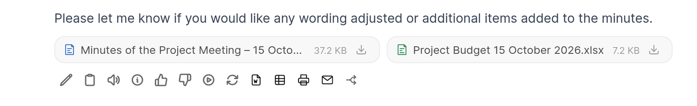

# Office File UI (optional browser script)

A small script for Open WebUI's `loader.js` hook. It is not a plugin: it changes the page in the browser.

For files attached to an answer of the assistant (e.g. by the Office Documents tool):

- they are shown below the text of the answer instead of above it
- each file is one chip, fitted to its name, with its icon coloured by type (Word, Excel,
  PowerPoint) and a download icon: the icon downloads the file, the rest of the chip opens the preview
- Word, Excel and PowerPoint files open straight in the **Preview** tab of the file view; the
  **Content** tab (the extracted text) and the "extracted lines" note are hidden
- a download button in the header of the file view

Files the user uploads and file views elsewhere (workspace, knowledge, chat controls) stay unchanged,
so the "Content" tab still shows what the model received from an upload.




Tested with Open WebUI 0.12.4. It depends on Open WebUI's
markup, so check it after every update. If the markup changes, the icons and the tab switch just
stop appearing; nothing else breaks: the "Content" | "Preview" bar is only hidden while the preview
is really shown.

The script stays light in long chats: it handles page changes at most every 150 ms, and if a chip has
no matching file in the saved chat, it loads the chat again at most three times for that chip, with
growing pauses (2, 8 and 32 seconds), instead of on every change.

## Install

File: [`loader.js`](loader.js).

Open WebUI loads `/static/loader.js` on every page. At startup it empties its static directory and copies
the file again from the frontend build, so put the script **into the frontend build**:

| Installation | File to replace |
|---|---|
| pip / uv | `<site-packages>/open_webui/frontend/static/loader.js` |
| Docker | `/app/build/static/loader.js` (mount it read-only) |

An update of Open WebUI overwrites the file. With systemd, copy it on every start:

```ini
[Service]
ExecStartPre=/bin/cp /opt/open-webui-extras/loader.js <site-packages>/open_webui/frontend/static/loader.js
```

With Docker:

```yaml
volumes:
  - ./loader.js:/app/build/static/loader.js:ro
```

Restart Open WebUI and reload the page (Ctrl+F5).
