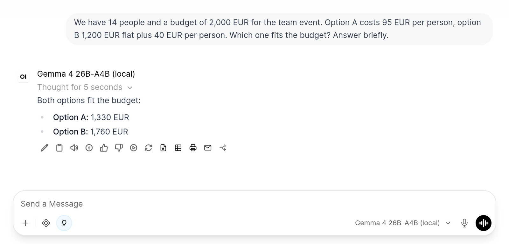

# Reasoning Toggle

An Open WebUI **toggle filter** that adds a lightbulb button to the chat input. While it is on, the model
thinks before it answers, and Open WebUI shows the reasoning as the usual collapsible block above the
answer. Made for local reasoning models on **vLLM** and **llama-server**, e.g. Qwen3.x, Gemma 4, GLM or
gpt-oss.

- Users switch it on in the **Integrations** menu (the button next to **+** in the chat input). While
  it is on, a lightbulb shows in the chat input; clicking it switches it off again. Open WebUI shows
  toggle filters in the chat input only while they are on, so there is no permanently visible
  switch. **Default Filters** in the model settings can switch it on by default.
- When it is on, the request gets `chat_template_kwargs: {"enable_thinking": true}`. vLLM and
  llama-server both hand this to the model's chat template. An optional effort level and token budget
  per model come on top (valves below).
- When it is off, the filter does not run at all, and the model behaves as configured. Models that
  think by default, such as Qwen3.x, keep thinking, so switch thinking off as their default (see
  below).

## Install

File: [`reasoning_toggle.py`](reasoning_toggle.py). Install it under **Admin Panel → Functions**, see
[Installation](../README.md#installation), and enable it **per model**, only for models that can
reason. Enabled globally, its button also shows up for models where it does nothing.

## Make "no thinking" the default

For models that think by default, open the model's settings (**Admin Panel → Settings → Models**,
or **Workspace → Models** for custom models), go to **Advanced Params** and set **Reasoning Effort**
to `none`. vLLM and llama-server then switch thinking off, and while the button is on, the filter
replaces `none` with the template's default or the configured level. Title and tag generation stay
fast as well. Gemma 4's chat template does not think unless asked to, so on vLLM it needs no default;
llama-server switches thinking on for every request by default, so set `none` there as well.

## Effort levels and budget

| Valve | Default | Description |
|---|---|---|
| `priority` | `0` | Filter order (lower runs first) |
| `model_reasoning_effort` | _(empty)_ | Optional effort level per model as `model_id=level` pairs, e.g. `qwen3.8-27b=medium, gpt-oss-120b=high`. Without an entry, the chat template's default applies (Qwen3.8: `xhigh`, gpt-oss: `medium`) |
| `thinking_budget` | `0` | Maximum reasoning tokens per answer; `0` means no limit |
| `model_thinking_budget` | _(empty)_ | Optional per-model budgets as `model_id=tokens` pairs, e.g. `gemma-4-26b=4000`. `0` switches the limit off for that model |

Workspace models use the entry of their base model unless they have one of their own.

- **Effort levels depend on the model.** The level is passed to the chat template, which decides what
  it means. Qwen3.8 knows `low`, `medium` and `xhigh` and rejects `high`, so the request fails; gpt-oss
  knows `low`, `medium` and `high`. Gemma 4 has no levels and ignores the setting. Check the model card
  or chat template before you add an entry.
- **The budget is a hard cap.** When it is used up, the server ends the reasoning and the model has
  to answer. Too small a budget makes answers worse: on a counting task, Gemma 4 gave a wrong answer
  with 64 tokens and the right one with 300. The budget is sent as `thinking_budget_tokens`
  (llama-server) and `thinking_token_budget` (vLLM); each server ignores the other's name.
- **vLLM needs `--reasoning-parser`** (and, for some models, `--reasoning-config`) for the budget,
  otherwise it rejects every request that carries one. Leave the budget at `0` until that is set up.
- If you use [Context Guard](../context-guard/), keep the budget below its `answer_reserve_tokens`, as
  the reasoning counts towards the answer.

## Why not Open WebUI's Model Controls?

Since 0.12.0, Open WebUI has **Model Controls**: a Thinking control in the model editor whose options
set custom parameters, picked from a knobs button in the chat input. They only show for users with
both **Allow Chat Controls** and **Allow Chat Params** (`USER_PERMISSIONS_CHAT_CONTROLS`,
`USER_PERMISSIONS_CHAT_PARAMS`), and the server ignores the choice otherwise. Those two permissions
also open the Chat Controls side panel, where users can change temperature, max tokens, context size
and the other advanced parameters. There is no permission for Model Controls alone.

A toggle filter needs neither permission. If your users get no chat controls, this filter is the way
to let them switch thinking on. If they may use chat controls anyway, Model Controls are the built-in
alternative.

## Security & privacy

No network access, nothing is stored or logged. Only `chat_template_kwargs`, `reasoning_effort` and
the two budget fields are set; messages are left untouched. Enable the filter only for local models:
cloud APIs such as OpenAI's reject unknown parameters like `chat_template_kwargs`.
