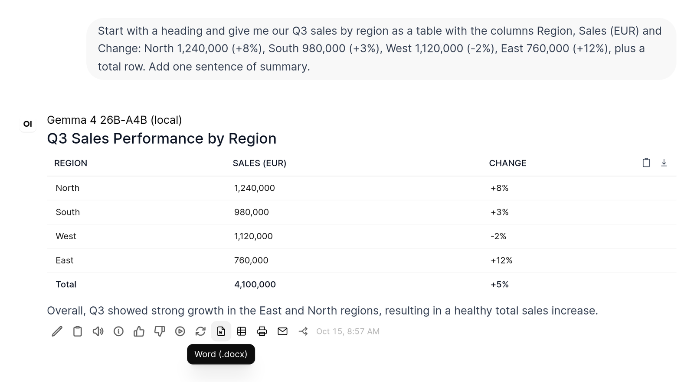
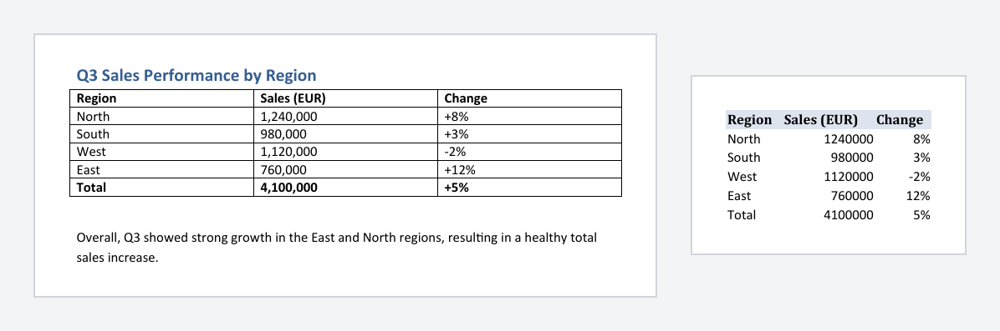

# Response Export

An Open WebUI **action** that adds four buttons below every assistant message:

| Button | Result |
|---|---|
| **Word (.docx)** | Word document with headings, bullet and numbered lists (one nesting level, numbering restarts for each list), tables with a bold header row, bold/italic/strikethrough/inline code, links shown as `text (url)`, code blocks and quotes |
| **Excel (.xlsx)** | One worksheet per Markdown table. The header row is bold, shaded and frozen, with an auto filter and fitted column widths. Numbers become real numbers, including German formats (`1.234,56`, `12,5 %`, `1.234,56 €`), `$`/`£` amounts and the codes `EUR`, `USD` and `GBP` |
| **PDF** | Opens the browser's print dialog with a clean A4 layout and a small footer. Choose "Save as PDF". The suggested file name is the first heading plus a timestamp |
| **E-Mail** | Opens the default mail program through a `mailto:` link. A `Subject:`/`Betreff:` line becomes the subject, and any preamble before it ("Here is a draft:") is dropped. If the answer is too long for a `mailto:` link, an `.eml` draft with plain-text and HTML parts is downloaded instead. Outlook opens it as a new, editable message |

Reasoning and tool-call blocks (`
…
`, `<think>…</think>`) are removed before
exporting. File names use the first heading of the answer plus a timestamp, e.g.
`Quarterly report 2026-10-12 1405.docx`.

## Install

File: [`response_export.py`](response_export.py). Install it under **Admin Panel → Functions** and
enable it globally or per model, see [Installation](../README.md#installation).

## Valves

| Valve | Default | Description |
|---|---|---|
| `language` | `en` | Language of the buttons, messages, default file names and print footer (`en` or `de`) |
| `timezone` | _(empty)_ | IANA time zone for file name timestamps and the footer date, e.g. `Europe/Berlin`. Empty means server time, which is often UTC in Docker |
| `max_mailto_length` | `1900` | Longest `mailto:` link handed to the mail program (Outlook on Windows handles about 2000 characters). Longer answers are downloaded as `.eml` |
| `always_eml` | `false` | Always download a formatted `.eml` draft instead of a plain-text `mailto:` link |
| `print_footer` | `true` | Add the "Created with the AI assistant on …" footer to printed pages |

## Security & privacy

- Everything is generated in memory on the server and sent straight to the user's browser. There is
  no network access and no shell, and nothing is written to disk or stored.
- The browser receives the generated file (base64), the `mailto:` link or the print page, wrapped in
  a fixed JavaScript snippet delivered through Open WebUI's `execute` event. All dynamic values are
  JSON-encoded.
- **CSP requirement:** the `execute` event runs code with `new Function(...)`. If your reverse
  proxy sets a `Content-Security-Policy`, it must allow `'unsafe-eval'`, otherwise the buttons do
  nothing. Open WebUI sets no CSP by default.
- The print page runs in a hidden same-origin iframe, so model output is never trusted as HTML:
  - raw HTML in the answer is always escaped;
  - links are only created for `http`, `https`, `mailto` and `tel`;
  - images are not loaded and are shown as links instead, so there are no tracking pixels;
  - the page carries its own strict CSP (`default-src 'none'`).
- Excel cells are written as text or numbers, never as formulas, so a cell such as `=HYPERLINK(...)`
  stays plain text.
- The e-mail is never sent by the plugin. The user's own mail program opens it as a draft.

## Notes and limitations

- **Ambiguous numbers in Excel:** a dot or comma followed by exactly three digits is read as a
  thousands separator, so `2.000` becomes 2000 and `1,234` becomes 1234. Integers with a leading
  zero (postcodes, IDs) and numbers with more than 15 digits stay text.
- **`.eml` drafts:** Outlook (Windows/Mac) opens them as editable drafts thanks to the
  `X-Unsent: 1` header. Thunderbird and Apple Mail open them as received messages, so use
  "Edit as new" or forward them.
- **Button labels** are language-neutral ("Word (.docx)", "Excel (.xlsx)", "PDF", "E-Mail"): Open WebUI
  builds the button list without loading the valves, so translated labels would only switch after the
  first click. Messages, file names and the print footer follow the `language` valve.
